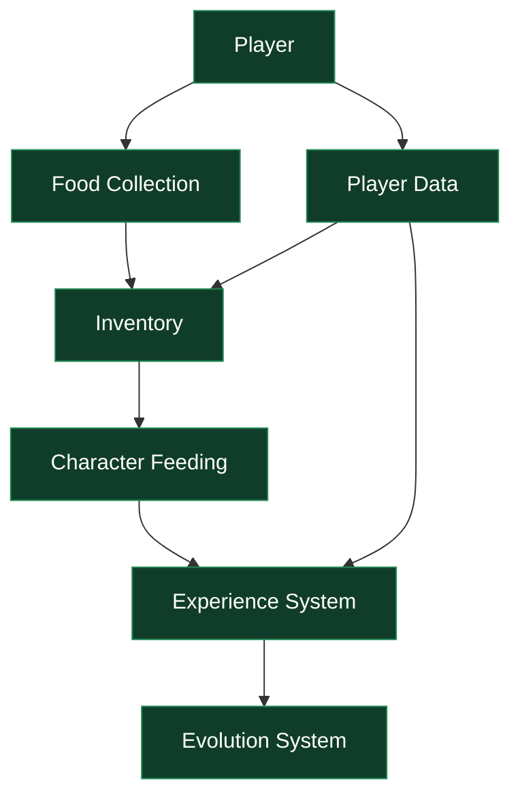
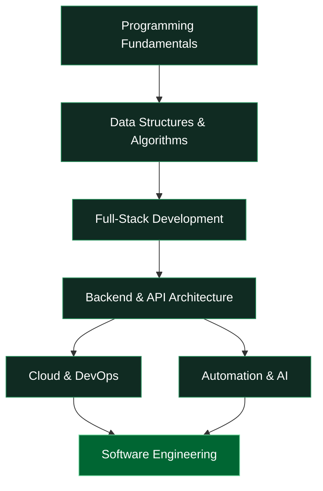

<!-- ================================================== -->
<!--          KRITTIN | PERSONAL GITHUB PROFILE          -->
<!-- ================================================== -->

  

  <h1>กฤตติณณ์ | Krittin</h1>

  <h3>Software Development · Full-Stack · Automation</h3>

  

    นิสิตสาขาเทคโนโลยีสารสนเทศ 
    คณะศิลปศาสตร์และวิทยาศาสตร์ 
    มหาวิทยาลัยเกษตรศาสตร์ วิทยาเขตกำแพงแสน
  

  
  
  

    

  
  

    

  <a href="#about">เกี่ยวกับผม</a>
  &nbsp;·&nbsp;
  <a href="#skills">ทักษะ</a>
  &nbsp;·&nbsp;
  <a href="#projects">ผลงาน</a>
  &nbsp;·&nbsp;
  <a href="#activity">กิจกรรม</a>
  &nbsp;·&nbsp;
  <a href="#contact">ติดต่อ</a>

 

<!-- ================================================== -->
<!--                     ABOUT ME                       -->
<!-- ================================================== -->

## 01 / เกี่ยวกับผม

สวัสดีครับ ผมกฤตติณณ์ ปัจจุบันกำลังศึกษาอยู่ในสาขาเทคโนโลยีสารสนเทศ มหาวิทยาลัยเกษตรศาสตร์ วิทยาเขตกำแพงแสน

ผมสนใจการพัฒนาซอฟต์แวร์ การออกแบบระบบ และการนำเทคโนโลยีมาประยุกต์ใช้แก้ไขปัญหา โดยเฉพาะการพัฒนาเว็บแอปพลิเคชัน ระบบเบื้องหลัง และการเชื่อมต่อบริการต่าง ๆ เข้าด้วยกัน

ปัจจุบันกำลังสะสมประสบการณ์ผ่านการลงมือพัฒนาโปรเจกต์จริง พร้อมศึกษาหลักการ Software Engineering และเทคโนโลยีใหม่ ๆ เพื่อพัฒนาทักษะของตนเองอย่างต่อเนื่อง

 

<table>
  <tr>
    <td width="30%"><b>การศึกษา</b></td>
    <td>Information Technology — Kasetsart University</td>
  </tr>
  <tr>
    <td><b>ความสนใจหลัก</b></td>
    <td>Software Engineering, Full-Stack Development</td>
  </tr>
  <tr>
    <td><b>กำลังศึกษาเพิ่มเติม</b></td>
    <td>Go, Cloud Computing, AI และ Backend Architecture</td>
  </tr>
  <tr>
    <td><b>เป้าหมายในสายอาชีพ</b></td>
    <td>Software Engineer / Full-Stack Developer</td>
  </tr>
  <tr>
    <td><b>สถานที่</b></td>
    <td>Thailand</td>
  </tr>
</table>

 

<!-- ================================================== -->
<!--                  AREAS OF INTEREST                 -->
<!-- ================================================== -->

### ขอบเขตความสนใจ

<table>
  <tr>
    <td width="50%" valign="top">
      
      <h3>Software Engineering</h3>
      
การออกแบบและพัฒนาซอฟต์แวร์ที่มีโครงสร้างชัดเจน สามารถทดสอบ ปรับปรุง และดูแลรักษาได้

    </td>
    <td width="50%" valign="top">
      
      <h3>Full-Stack Development</h3>
      
การพัฒนาเว็บแอปพลิเคชันตั้งแต่ส่วนติดต่อผู้ใช้ไปจนถึงระบบเบื้องหลังและ API

    </td>
  </tr>
  <tr>
    <td width="50%" valign="top">
      
      <h3>Automation & Integration</h3>
      
การสร้างระบบอัตโนมัติ เชื่อมต่อบริการ และลดขั้นตอนการทำงานที่ซ้ำซ้อน

    </td>
    <td width="50%" valign="top">
      
      <h3>Cloud & AI</h3>
      
การศึกษาโครงสร้างพื้นฐานบน Cloud และการประยุกต์ใช้ปัญญาประดิษฐ์กับซอฟต์แวร์

    </td>
  </tr>
</table>

 

---

<!-- ================================================== -->
<!--                    TECH STACK                      -->
<!-- ================================================== -->

## 02 / เทคโนโลยีและเครื่องมือ

ภาษาโปรแกรม Framework และเครื่องมือที่ใช้งานหรือกำลังพัฒนาทักษะผ่านการเรียนและโปรเจกต์ส่วนตัว

<table>
  <tr>
    <td align="center" width="33%">
      <h3>Languages</h3>
      
        
      Python · JavaScript · TypeScript
        
    </td>
    <td align="center" width="33%">
      <h3>Frontend</h3>
      
        
      HTML · CSS · React
        
    </td>
    <td align="center" width="33%">
      <h3>Backend</h3>
      
        
      Node.js · Python · API
        
    </td>
  </tr>
  <tr>
    <td align="center">
      <h3>Development</h3>
      
        
      Git · GitHub · VS Code
        
    </td>
    <td align="center">
      <h3>DevOps & API</h3>
      
        
      Docker · Postman · Webhooks
        
    </td>
    <td align="center">
      <h3>Automation</h3>
      
        
      n8n · Workflow · Integration
        
    </td>
  </tr>
</table>

### เทคโนโลยีที่กำลังศึกษาเพิ่มเติม

<table>
  <tr>
    <td align="center" width="25%">
      
        
      <b>Go</b>
       
      Backend Development
    </td>
    <td align="center" width="25%">
      
        
      <b>Cloud</b>
       
      Cloud Infrastructure
    </td>
    <td align="center" width="25%">
      
        
      <b>AI</b>
       
      AI Integration
    </td>
    <td align="center" width="25%">
      
        
      <b>Data Analytics</b>
       
      Data Processing
    </td>
  </tr>
</table>

 

---

<!-- ================================================== -->
<!--                  FEATURED PROJECTS                 -->
<!-- ================================================== -->

## 03 / ผลงานและโปรเจกต์

โปรเจกต์จากการเรียนและการพัฒนาส่วนตัวที่นำความรู้ด้านเทคโนโลยีมาประยุกต์ใช้ในการสร้างระบบจริง

 

### Smart Job Matcher

ระบบจับคู่งานที่ประยุกต์ใช้ Workflow Automation เพื่อเชื่อมต่อข้อมูล ประมวลผลตามเงื่อนไข และลดขั้นตอนการทำงานที่ต้องดำเนินการด้วยตนเอง

**แนวทางการทำงานของระบบ**

**องค์ประกอบที่ศึกษาและพัฒนา**

- Workflow Automation
- Webhook และ API Integration
- การประมวลผลข้อมูลตามเงื่อนไข
- การเชื่อมต่อบริการภายนอก
- ระบบแจ้งเตือนอัตโนมัติ

**เทคโนโลยีที่เกี่ยวข้อง**

 

### Eat & Evolve

โปรเจกต์พัฒนาเกมบน Roblox ที่มุ่งเน้นการออกแบบระบบข้อมูลผู้เล่น การสะสมทรัพยากร การพัฒนาตัวละคร และระบบความก้าวหน้าภายในเกม

**โครงสร้างระบบหลัก**

**องค์ประกอบที่ศึกษาและพัฒนา**

- Player Data Management
- Inventory & Resource Collection
- Character Progression
- Character Evolution
- Multiplayer Architecture
- Server-side Validation

**เทคโนโลยีที่เกี่ยวข้อง**

 

  

 

---

<!-- ================================================== -->
<!--                 LEARNING ROADMAP                   -->
<!-- ================================================== -->

## 04 / การพัฒนาทักษะและเป้าหมาย

| ด้านที่พัฒนา | สิ่งที่ให้ความสำคัญ |
| :--- | :--- |
| **Programming** | การแก้ปัญหาและเขียนโค้ดอย่างเป็นระบบ |
| **Data Structures & Algorithms** | การจัดการข้อมูลและประสิทธิภาพของโปรแกรม |
| **Full-Stack Development** | การพัฒนาระบบ Frontend และ Backend |
| **Backend Engineering** | การออกแบบ API และโครงสร้างระบบ |
| **Automation** | การเชื่อมต่อและสร้างกระบวนการอัตโนมัติ |
| **Cloud & DevOps** | การ Deploy และดูแลระบบ |
| **Software Architecture** | การออกแบบซอฟต์แวร์ที่รองรับการขยายตัว |

 

  
<b>เป้าหมายระยะยาวในสายอาชีพ</b>

   

  มีเป้าหมายในการพัฒนาตนเองสู่สายงาน Software Engineering และ Full-Stack Development โดยให้ความสำคัญกับคุณภาพของซอฟต์แวร์ ความสามารถในการดูแลรักษาระบบ และการออกแบบระบบที่สามารถรองรับการเติบโตในอนาคต

  - พัฒนาความเข้าใจด้าน Software Architecture
  - ออกแบบระบบ Backend และ API
  - ศึกษา Cloud Infrastructure และ DevOps
  - พัฒนาประสบการณ์จากโปรเจกต์จริง
  - เรียนรู้แนวทางการทำงานร่วมกันในทีมพัฒนาซอฟต์แวร์

 

---

<!-- ================================================== -->
<!--                  GITHUB ACTIVITY                   -->
<!-- ================================================== -->

## 05 / กิจกรรมบน GitHub

  

   

  
  

    

  <h3>Contribution Streak</h3>

  

    

  <h3>Development Activity</h3>

  

   

  ข้อมูลกิจกรรมและสถิติจากบัญชี GitHub ซึ่งอัปเดตโดยบริการภายนอกอัตโนมัติ

 

---

<!-- ================================================== -->
<!--                     EDUCATION                      -->
<!-- ================================================== -->

## 06 / ประวัติการศึกษา

<table>
  <tr>
    <td width="25%" align="center">
      <h1>KU</h1>
      
        
      <b>KASETSART UNIVERSITY</b>
    </td>
    <td width="75%">
      <h2>มหาวิทยาลัยเกษตรศาสตร์</h2>
      <b>วิทยาเขตกำแพงแสน</b>
        
      คณะศิลปศาสตร์และวิทยาศาสตร์
       
      สาขาเทคโนโลยีสารสนเทศ
        
      <code>Undergraduate</code>
      <code>Information Technology</code>
        
      <a href="https://www.ku.ac.th/">เว็บไซต์มหาวิทยาลัย</a>
    </td>
  </tr>
</table>

 

---

<!-- ================================================== -->
<!--                      CONTACT                       -->
<!-- ================================================== -->

## 07 / ช่องทางการติดต่อ

  

    ยินดีแลกเปลี่ยนความรู้และร่วมพัฒนาโปรเจกต์ด้านเทคโนโลยี 
    รวมถึงโอกาสในการฝึกงานและพัฒนาประสบการณ์ด้านซอฟต์แวร์
  

   

  

    

  

    

  
    Information Technology · Faculty of Liberal Arts and Science
     
    Kasetsart University, Kamphaeng Saen Campus
  

    

  

<!-- ================================================== -->
<!--                    END OF PROFILE                  -->
<!-- ================================================== -->
